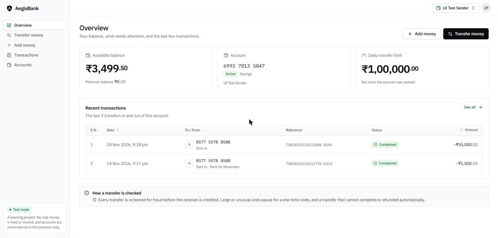
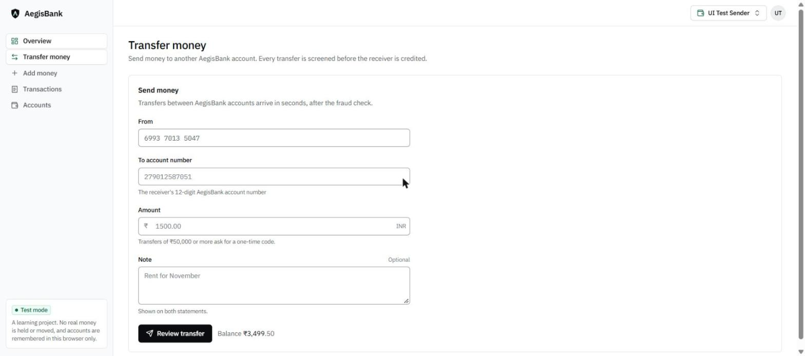
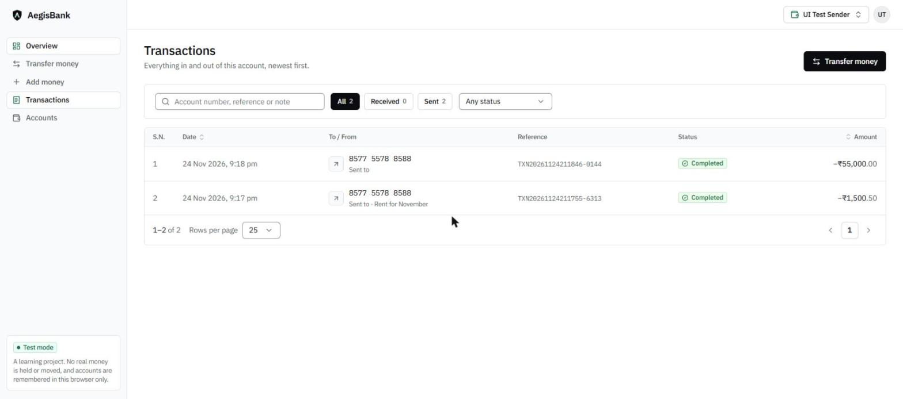

<div align="center">

# AegisBank 🏦

**An event-driven digital bank — six Spring Boot microservices, a Kafka backbone, a SAGA that never leaves money stranded, and a real-time fraud engine that can hold a transfer for a one-time code.**

[](https://openjdk.org/)
[](https://spring.io/projects/spring-boot)
[](https://kafka.apache.org/)
[](https://www.postgresql.org/)
[](https://redis.io/)
[](https://nextjs.org/)
[](https://www.docker.com/)

</div>

---

Money that moves between two independent databases can't be rolled back by a transaction manager.
AegisBank solves that the way real payment systems do: a **SAGA orchestrator** with compensating
events. Every transfer is debited first, screened for fraud asynchronously, and either credited to
the receiver, held for a one-time code, or **automatically refunded** — never left in limbo.

## Screens

The customer app is a Next.js 16 front end that talks to the services only through the API gateway.

| Overview |
|---|
|  |

| Transfer money | Transaction history |
|---|---|
|  |  |

## What makes it interesting

- **SAGA with real compensation.** `transaction-service` orchestrates: debit the sender → publish
  `transaction.initiated` → wait for the fraud verdict → credit the receiver. Any failure, a fraud
  verdict, or a failed OTP triggers a compensating event that refunds the sender and locks the account.
- **Fraud detection on the event stream.** `fraud-detection-service` consumes `transaction.initiated`
  and scores it against three rules — **velocity** (too many transfers in one minute, counted in Redis),
  **unusual amount** (far above the account's own average) and **balance drain** (too large a share of
  the balance). All thresholds come from `.env`, and none of it sits in the request path.
- **Step-up verification.** A suspicious transfer parks in `PENDING_VERIFICATION`. The OTP is stored in
  Redis as a **SHA-256 hash** with a TTL and travels to the customer over its own Kafka topic — it is
  never returned to the browser. Three wrong attempts refund the sender and flag the transfer.
- **The API answers before the money settles.** `POST /transfer` returns `PROCESSING`, because the final
  status arrives over Kafka. The UI is built around that truth: it polls until the status stops moving
  instead of claiming success.
- **Defensive by default.** Per-IP rate limiting in Redis at the gateway, pessimistic row locks on every
  balance change, `BigDecimal` money throughout, idempotent Razorpay webhooks with verified signatures,
  RFC 9457 `ProblemDetail` errors with stable machine-readable codes, and a dead-letter topic behind
  every consumer.
- **Money endpoints are unreachable from the internet.** Anything that moves money between services
  lives under `/internal/**`, which the gateway deliberately does not route.

## Architecture

```
                      ┌──────────────────────┐
   Browser ──────────▶│  Next.js (BFF proxy) │   no CORS, no service URLs in the client
                      └──────────┬───────────┘
                                 │  /api/v1/**
                      ┌──────────▼───────────┐
                      │  API Gateway :8080   │   per-IP rate limit (Redis)
                      └──────────┬───────────┘
            ┌────────────────────┼────────────────────┐
            ▼                    ▼                    ▼
   ┌─────────────────┐  ┌──────────────────┐  ┌─────────────────┐
   │ account-service │◀─│ transaction-svc  │  │ payment-service │
   │     :8081       │  │  :8082  (SAGA)   │  │     :8083       │
   └────────┬────────┘  └────────┬─────────┘  └────────┬────────┘
            │                    │                     │
            │            ┌───────▼─────────────────────▼───────┐
            └───────────▶│          Apache Kafka               │
                         └───────┬──────────────────┬──────────┘
                                 ▼                  ▼
                    ┌────────────────────┐  ┌─────────────────────┐
                    │ fraud-detection    │  │ notification        │
                    │      :8084         │  │      :8085          │
                    └────────────────────┘  └─────────────────────┘

   Topics: transaction.initiated / completed / refunded · fraud.detected
           transaction.otp.generated · payment.completed / failed
```

| Service | Port | Database | Also uses |
|---|---|---|---|
| `api-gateway` | 8080 | – | Redis (rate limiting) |
| `account-service` | 8081 | `account_db` | Postgres, Kafka |
| `transaction-service` | 8082 | `transaction_db` | Postgres, Kafka, OpenFeign |
| `payment-service` | 8083 | `payment_db` | Postgres, Kafka, Razorpay |
| `fraud-detection-service` | 8084 | – | Redis, Kafka |
| `notification-service` | 8085 | – | Kafka, Mail |
| `frontend` | 3000 | – | Next.js 16, React 19 |

Client routes are `/api/v1/accounts/**`, `/api/v1/transactions/**` and `/api/v1/payments/**`.
Health for any service: `http://localhost:<port>/actuator/health`.
Combined Swagger UI: <http://localhost:8080/swagger-ui.html>.

## Quick start

**Prerequisites:** Docker, JDK 25, and Node 26 + pnpm 12 for the front end.

```bash
git clone https://github.com/Ashjha75/AegisBank.git
cd AegisBank

# 1. Create every .env from its committed template, then fill in each <change-me>
for f in .env.example */.env.example; do cp -n "$f" "${f%.example}"; done

# 2. Infrastructure: Postgres, Redis, Kafka, Zookeeper, Adminer
docker compose up -d

# 3. Build and test all six services
./mvnw clean package

# 4. Run one service (or use the IntelliJ "All Services" run configuration)
./mvnw -pl account-service spring-boot:run
```

Front end:

```bash
cd frontend
cp .env.example .env
pnpm install
pnpm dev      # http://localhost:3000
```

> `frontend/.env` ships with `API_GATEWAY_URL=http://host.docker.internal:8080`, which is correct
> inside Docker. Running `pnpm dev` directly on your machine? Use `http://localhost:8080`.

Open <http://localhost:3000/app>, open an account, and send a transfer. Anything from ₹50,000 will
pause for a one-time code.

## Configuration

All configuration and secrets come from `.env` files. Each has a committed `.env.example` listing every
value it needs; the real `.env` files are git-ignored and **never** have defaults.

| File | Used by | Contains |
|---|---|---|
| `.env` (repo root) | `docker compose` | Postgres user/password, Redis password, host ports |
| `<service>/.env` | that Spring Boot service | port, DB / Redis / Kafka connection, service keys (Razorpay, mail, minimum balances) |
| `frontend/.env` | the Next.js server | gateway URL, timeout, docs-UI credentials |

`DB_PASSWORD` and `REDIS_PASSWORD` must match between the root `.env` and the service `.env` files.

- **Fail fast:** `docker compose` refuses to start without the root `.env`, and a service refuses to
  start without its own.
- **Overrides:** real environment variables always beat `.env` values.
- **Docker / CI** (environment variables only): set `APP_ENV_FILE=optional:file:.env[.properties]`.
- **Format:** service `.env` files are read as Java properties — `KEY=value`, no quotes. In the root
  `.env`, wrap values containing `$` in single quotes.

## Database

Postgres runs with a single user, **`aegisuser`** (`DB_USERNAME`), owning `aegisbankdb` (scratch),
`account_db`, `transaction_db` and `payment_db`.

Connect from IntelliJ/DBeaver with `jdbc:postgresql://localhost:5432/<db>`.

**Adminer:** <http://localhost:8090> — System `PostgreSQL`, Server `postgres`, Username `aegisuser`,
Password = your `DB_PASSWORD`. Leave **Database** empty to land on a list of all of them.

```bash
# another database
docker exec postgres psql -U aegisuser -d aegisbankdb -c "CREATE DATABASE my_db;"
```

> The user, password and databases are only created while the `postgres-data` volume is empty.
> After changing them, reset it (**deletes all database data**):
> `docker compose rm -sf postgres && docker volume rm aegisbank_postgres-data && docker compose up -d postgres`

## Project layout

```
AegisBank/
├── api-gateway/              routing + per-IP rate limiting
├── account-service/          accounts, balances, locking
├── transaction-service/      transfers, the SAGA, OTP verification
├── payment-service/          Razorpay orders and webhooks
├── fraud-detection-service/  risk rules over the Kafka stream
├── notification-service/     alerts
├── frontend/                 Next.js 16 customer app + internal docs UI
├── docker-compose.yml        Postgres, Redis, Kafka, Zookeeper, Adminer
├── PENDING.md                what is deliberately not done yet
└── pom.xml                   Maven multi-module aggregator
```

The root is a Maven **multi-module** project — open the root folder in IntelliJ and all six services
import at once. The front end is not a Maven module.

## Project status

Built as a learning project, and honest about where it stands. The transfer, fraud, OTP, refund,
webhook and rate-limit flows are tested end to end; the customer UI is wired to all three
client-facing services.

**Not done yet** — tracked in [`PENDING.md`](PENDING.md):

- **No authentication.** The gateway is open and the UI identifies an account by a number kept in
  `localStorage`. This is the next piece of work, and nothing else should be read as production-ready
  until it lands.
- A completed Razorpay payment does not yet credit the account balance.
- The daily transaction limit is stored but not enforced.
- Events are fire-and-forget; a transactional outbox is the planned fix.
- No Flyway migrations yet (`ddl-auto: update`).

## Tech stack

**Backend** Java 25 · Spring Boot 4.1 · Spring Cloud Gateway · Spring Data JPA · OpenFeign · Apache Kafka · PostgreSQL · Redis · Razorpay · springdoc OpenAPI
**Frontend** Next.js 16 · React 19 · TypeScript · Tailwind CSS v4 · TanStack Query · Radix UI · Zod · Vitest
**Infrastructure** Docker · Docker Compose · Maven multi-module

---

<div align="center">
<sub>A learning project. Not a real bank — no real money is held or moved.</sub>
</div>
