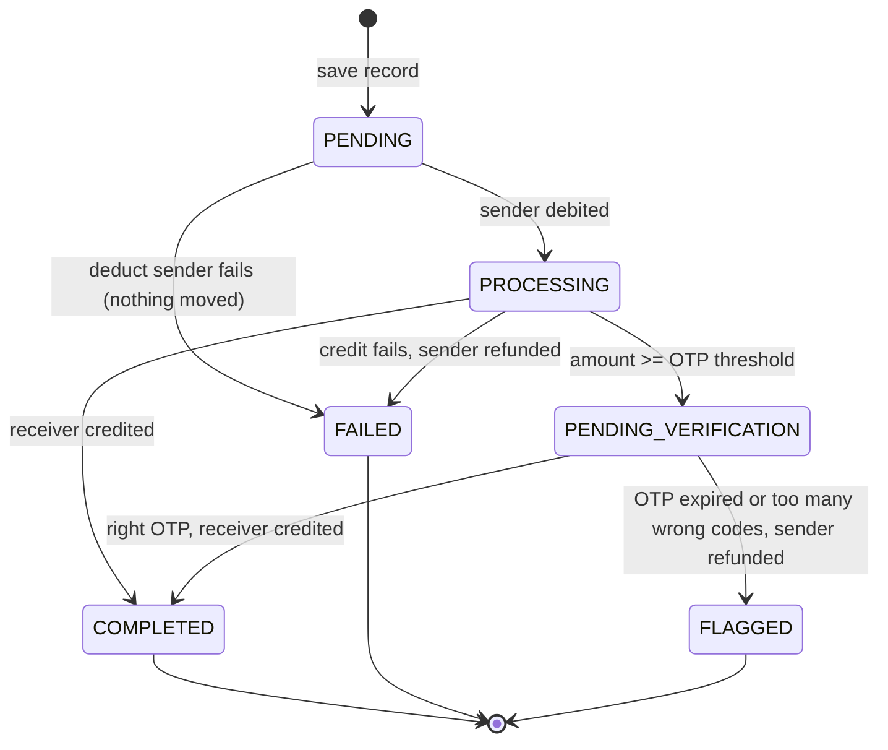

<Decision id="ADR-001" status="accepted" date="2026-11-22" deciders="Backend" />

## Context

A transfer changes two accounts. Balances live in **account-service** (`account_db`); the transfer record lives in
**transaction-service** (`transaction_db`). There is no database transaction that spans both services, and a
distributed transaction (two-phase commit) would couple the services and their databases tightly.

Some transfers also need to **pause**: amounts at or above the OTP threshold wait for the customer's code, which
can take minutes.

## Decision

transaction-service runs every transfer as an orchestrated **SAGA** (`TransactionService.transfer`):

- Every status change is **saved immediately** (Feign calls are not wrapped in one big DB transaction), so the
  table always shows how far a transfer got.
- When a later step fails, the earlier debit is **compensated** by refunding the sender.
- Money-moving calls (`deduct`, `credit`) are on `/internal/v1/**`, which the gateway never routes.

## Consequences

<Accordions>
  <Accordion title="Easier">
    Each service keeps its own database and can be deployed alone. A paused transfer (waiting for an OTP) is just a
    row in `PENDING_VERIFICATION` - no locks are held while the customer types the code.
  </Accordion>
  <Accordion title="Harder">
    Consistency is eventual: between the debit and the credit, the sender's balance is lower while the receiver's
    is not yet higher. A refund can itself fail; the transfer's `failureReason` then ends with
    `needs manual check`, and the case must be reconciled by hand.
  </Accordion>
  <Accordion title="To watch">
    Retries of the whole request must not debit twice. The frontend already sends an `Idempotency-Key` header with
    money-moving requests, but transaction-service does not enforce it yet - a retried request would start a second
    transfer. Enforcing it is open work. Monitoring should also alert on any `needs manual check` reason.
  </Accordion>
</Accordions>

## Alternatives considered

| Option | Why not |
| --- | --- |
| Two-phase commit across both databases | Couples the services; needs an XA coordinator; locks are held for the whole OTP wait. |
| One shared database for accounts and transactions | Breaks service ownership of data; the services could no longer evolve or scale independently. |
| Choreographed SAGA (services react to events) | More moving parts (a broker, event schemas) for a flow with only two participants. Worth revisiting when fraud and notification services join. |
