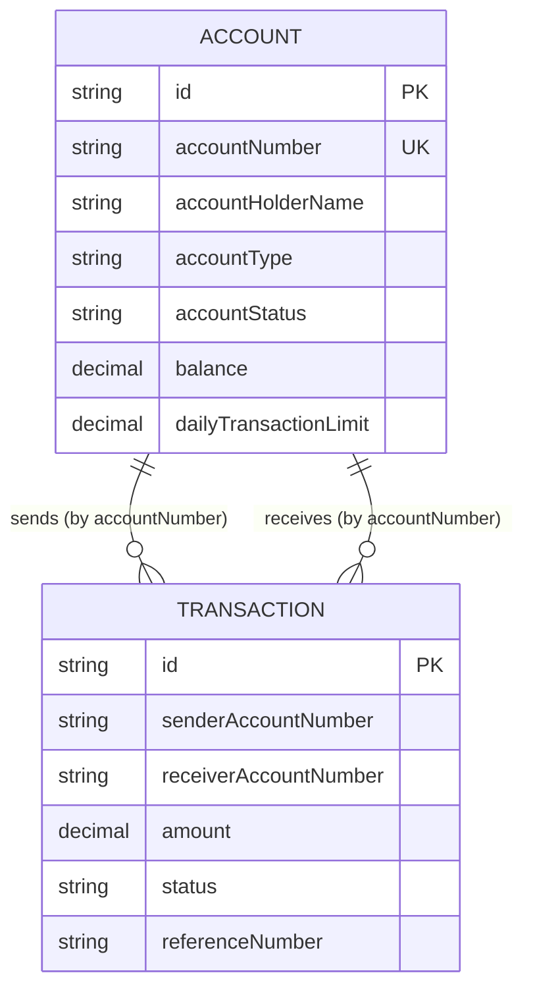
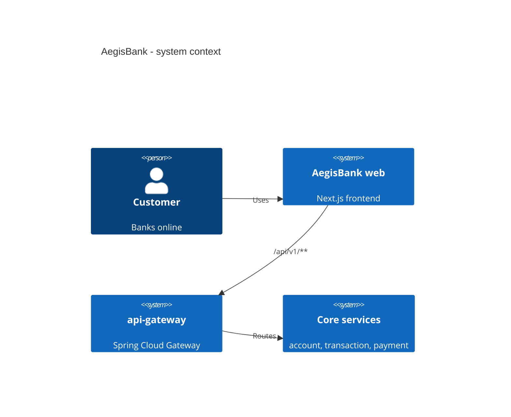

All of these work in any `.mdx` page under `content/docs` without imports. They follow the conventions of
well-known developer docs: Stripe-style API blocks, Nygard ADRs, Mermaid (sequence, state, ER, C4) for
system design, Shiki-highlighted code with tabs.

## Code blocks

Every fenced block gets syntax highlighting, line numbers, a copy button and an **expand** button (full screen,
<kbd>Esc</kbd> to close). Add a title with `title="..."`.

```ts title="src/lib/format.ts"
export function formatMoney(amount: number | string, currency = "INR"): string {
  const value = typeof amount === "string" ? Number(amount) : amount;
  if (!Number.isFinite(value)) return "—";
  return new Intl.NumberFormat("en-IN", { style: "currency", currency }).format(value);
}
```

Consecutive blocks with `tab="..."` become one tabbed block - ideal for the same request in several languages:

```bash tab="cURL"
curl http://localhost:8080/api/v1/transactions/health
```

```ts tab="TypeScript"
const health = await apiFetch("/v1/transactions/health");
```

```java tab="Java (Feign)"
@FeignClient(name = "transaction-service")
interface TransactionClient {
  @GetMapping("/api/v1/transactions/health")
  HealthResponse health();
}
```

Package installs: write the npm command once, readers pick their package manager.

```npm
npm install @phosphor-icons/react
```

````mdx title="How the blocks above are written"
```ts title="src/lib/format.ts"
...
```

```bash tab="cURL"
curl ...
```
```ts tab="TypeScript"
...
```

```npm
npm install @phosphor-icons/react
```
````

## Live example with code

<Example
  title="components/ui/button.tsx"
  code={`<Button>Send money</Button>
<Button variant="secondary">Cancel</Button>
<Button variant="brand">Confirm</Button>`}
>
  <Button>Send money</Button>
  <Button variant="secondary">Cancel</Button>
  <Button variant="brand">Confirm</Button>
</Example>

```mdx
<Example code={`<Button>Send money</Button>`}>
  <Button>Send money</Button>
</Example>
```

## API reference

An `<Endpoint>` groups one operation: method, path (with `{params}` highlighted and a copy button), who may call
it and the success status. Inside, describe the body with `<TypeTable>` and the outcomes with `<Responses>`.
See the real [Transaction API](../services/transaction-api.mdx).

<Endpoint method="GET" path="/api/v1/transactions/{transactionId}" auth="public" status="200 OK" summary="One transaction by its id.">
  <Responses
    items={[
      { status: 200, description: "The transaction." },
      { status: 404, code: "RESOURCE_NOT_FOUND", description: "No transaction with that id." },
    ]}
  />
</Endpoint>

<TypeTable
  type={{
    senderAccountNumber: { type: "string", description: "12 digits.", required: true },
    amount: { type: "number", description: "Greater than zero, 2 decimals.", required: true },
    description: { type: "string", description: "Up to 255 characters.", default: "null" },
  }}
/>

Inline methods: <MethodBadge method="GET" /> <MethodBadge method="POST" /> <MethodBadge method="PUT" />
<MethodBadge method="PATCH" /> <MethodBadge method="DELETE" />

```mdx
<Endpoint method="POST" path="/api/v1/transactions/transfer" auth="public" status="201 Created" summary="...">
  <TypeTable type={{ amount: { type: "number", required: true, description: "..." } }} />
  <Responses items={[{ status: 400, code: "VALIDATION_FAILED", description: "..." }]} />
</Endpoint>
```

## System design diagrams

Write a ` ```mermaid ` block - it renders as a diagram. Use the right kind for the question:

| Question | Diagram |
| --- | --- |
| Who calls whom, in what order? | `sequenceDiagram` |
| What states can a thing be in? | `stateDiagram-v2` |
| How are tables related? | `erDiagram` |
| What is the system and who uses it? | `C4Context` |
| How do the services connect right now? | `<ArchitectureMap />` (interactive) |





## Architecture decisions

Record significant decisions as ADRs in [Decisions](../decisions/index.mdx). The header:

<Decision id="ADR-001" status="accepted" date="2026-11-22" deciders="Backend" />

## Project structure

<Files>
  <Folder name="frontend" defaultOpen>
    <Folder name="content/docs" defaultOpen>
      <File name="meta.json" />
      <Folder name="services">
        <File name="transaction-api.mdx" />
      </Folder>
    </Folder>
    <Folder name="src">
      <Folder name="components/docs">
        <File name="mdx-components.tsx" />
      </Folder>
      <File name="proxy.ts" />
    </Folder>
  </Folder>
</Files>

## Callouts

<Callout type="tip">
  You can use <code>```bash tab="cURL"</code> fences to show the same request in several languages.
</Callout>

<Callout type="info" title="Note">Neutral background information.</Callout>

<Callout type="warn">Something that can go wrong if ignored.</Callout>

<Callout type="error">Something that loses data or money if ignored.</Callout>

<Callout type="success">A confirmation, or the expected result of a step.</Callout>

## Steps and FAQs

<Steps>
  <Step>
    ### Start the backend
    `docker compose up` in the repository root.
  </Step>
  <Step>
    ### Start the frontend
    `docker compose up --watch` in `frontend/`.
  </Step>
</Steps>

<Accordions>
  <Accordion title="Why are the docs behind a password?">
    They describe internal endpoints and decisions. `src/proxy.ts` asks for HTTP Basic credentials.
  </Accordion>
  <Accordion title="Where do the icons come from?">
    Lucide in the product, Phosphor in the docs: <Ph name="Bank" weight="duotone" /> <Ph name="Database" weight="duotone" />.
  </Accordion>
</Accordions>
